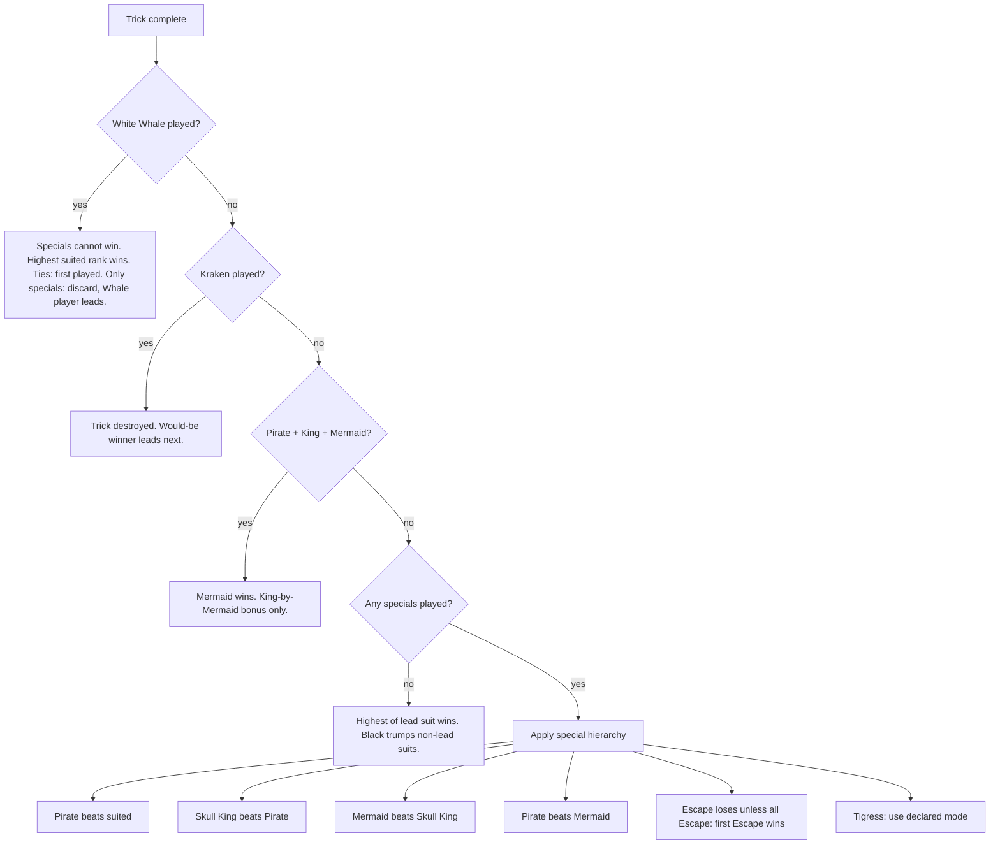

# Trick resolution

Use this at the table when multiple card types compete. For prose rules see [Card ranks](../rules/04-card-ranks.md).

## Decision flow



## Special beat order (no Whale)

```
Suited < Pirate < Skull King < Mermaid
         ↑___________________|
              Pirate beats Mermaid
```

Same special type → **first played** wins.

## Suited-only tricks

1. If all cards share the lead suit → highest rank of that suit wins.
2. If black played off-suit → black wins (highest black if multiple).
3. Off-suit non-trump cards do not beat in-suit cards.

## Kraken + Whale interaction

| Order played | Result |
|--------------|--------|
| Kraken first, Whale second | Whale rules |
| Whale first, Kraken second | Kraken rules |

## Loot alliance

When Loot is played and another player wins the trick, an automatic alliance is formed between the Loot player and the trick winner (+20 each if both make bid). If two Loots are played in one trick, each forms an independent alliance with the winner. If the trick winner played a Loot, no alliance is formed for that card. See [Scoring](../rules/06-scoring.md).

## Rulings & House Rules

These rulings document engine decisions on edge cases with formal citations:

1. **Character played after Escape lead (Audit Item 3):**
   - *Sources:* Official Rulebook p.12 (S1), Publisher FAQ. S1 states the next player chooses suit "unless they play one of these" (Escape, Tigress-as-Escape, Loot).
   - *GUB ruling:* Characters (Pirate, Mermaid, Skull King, Tigress-as-Pirate, Kraken, Whale) do not set a suit; playing a character ends suit selection (trick has no lead suit). Configurable via `escapeLeadDefersThroughCharacters` flag (default `false`).
2. **Multiple Loot cards in one trick (Audit Item 4):**
   - *Sources:* S1 p.25.
   - *GUB ruling:* Each Loot card forms its own alliance with the trick winner; a Loot played by the winner forms none.
3. **Mid-trick Kraken or Whale (Audit Item 5):**
   - *Sources:* S1 p.23–24. S1 specifies leading a creature requires no follow-suit.
   - *GUB ruling:* A mid-trick Kraken or Whale does *not* lift the follow-suit obligation for subsequent players. If a suited card led, remaining players holding that suit must follow it.

## Related

- [Leading specials](../rules/05-leading-specials.md)
- [Advanced cards](../rules/07-advanced-cards.md)
- [FAQ](../rules/10-faq.md)
